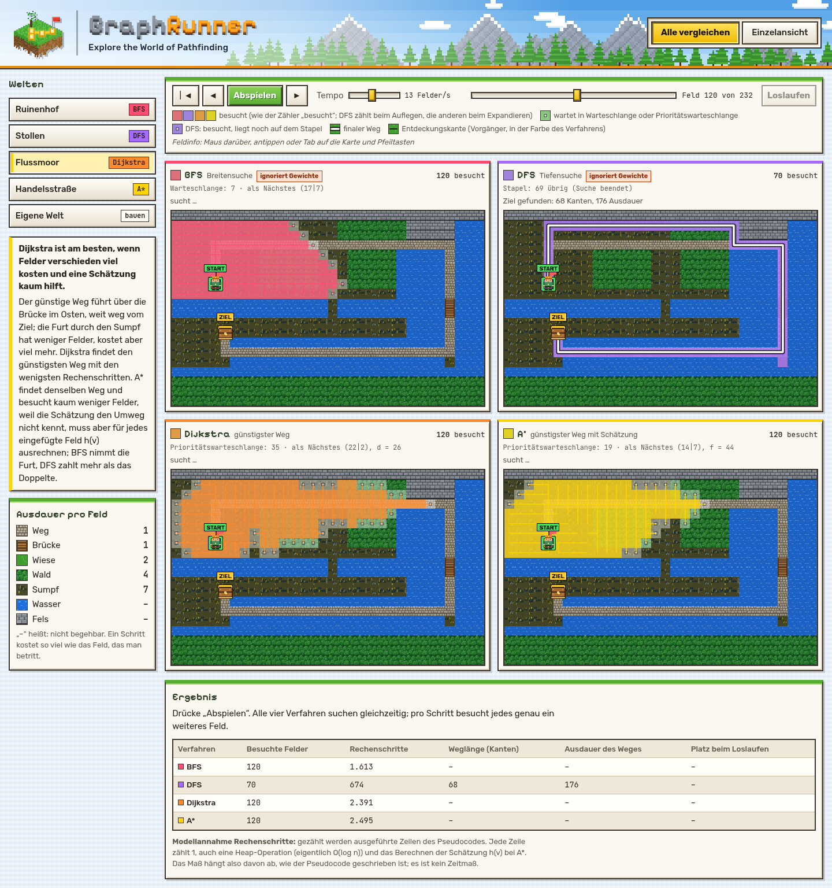

# GraphRunner

Ein Pixel-Spiel im Klötzchenstil im Browser, die zeigt, **wann welcher Suchalgorithmus der beste ist**: BFS, DFS, Dijkstra und A* suchen gleichzeitig auf derselben Karte, Schritt für Schritt und mit Pseudocode.

**Live:** https://xeniannr-hub.github.io/graphrunner/



Hochschulprojekt im Modul *Theoretische Informatik* an der DHBW Ravensburg. Thema: „Visualisierung grundlegender Graphensuchalgorithmen mit GUI oder Web-App“.

## Welten

Für jedes Verfahren gibt es eine Welt, deren Gelände zeigt, wann es am besten passt. Die Bedingungen in der rechten Spalte prüft `src/world/worlds.test.ts`.

| Welt | Verfahren | … ist am besten, wenn … | Messbare Bedingung |
| --- | --- | --- | --- |
| Ruinenhof | BFS | jeder Schritt gleich viel kostet | nur Wiese und Felsmauern; BFS-Kosten = Dijkstra-Kosten; A* besucht > 85 % von BFS; DFS besucht > 2 × BFS, Weg > 1,5 × so lang |
| Stollen | DFS | es nur einen Weg gibt und das Ziel tief liegt | perfektes Labyrinth; alle finden denselben Weg; DFS besucht < 70 % jedes anderen |
| Flussmoor | Dijkstra | Felder verschieden viel kosten und eine Schätzung kaum hilft | A*-Kosten = Dijkstra; A* besucht > 95 % von Dijkstra; BFS zahlt > 1,5 ×, DFS > 2 × |
| Handelsstraße | A* | das Ziel weit weg liegt und seine Richtung bekannt ist | A*-Kosten = Dijkstra; A* besucht < 25 % von Dijkstra und am wenigsten; BFS zahlt > 1,2 × |
| Eigene Welt | – | selbst bauen | startet als leere Wiese |

## Bedienung

- **Alle vergleichen:** vier Karten nebeneinander. Ein Schritt heißt: Jedes Verfahren besucht ein weiteres Feld. Darunter stehen die beste Wahl der Welt mit Begründung, ein Fazit und eine Tabelle mit besuchten Feldern, Rechenschritten, Weglänge und Ausdauer. Einen ★ für wenig Suchaufwand bekommt nur, wer den optimalen Weg gefunden hat. Am Ende zeigt „Loslaufen“, wer den günstigsten Weg gefunden hat.
- **Einzelansicht:** ein Verfahren Zeile für Zeile, mit Pseudocode, Erklärsatz und Besuchsreihenfolge.
- **Tastatur:** `←` / `→` ein Schritt, Leertaste Abspielen oder Anhalten.
- **Eigene Welt:** Werkzeug wählen, dann auf eine Karte klicken oder darüber ziehen. Alle Verfahren rechnen sofort neu. „Karte leeren“ macht alles wieder zu Wiese.
- **Tooltip:** Über jedem Feld stehen Koordinate, Gelände, Ausdauer, die ausgehenden Kanten mit Gewicht (z. B. `Kanten: ↑ 2 · → 4 · ↓ – · ← 2`) und die Besuchsnummer. So sieht man die Karte als Graph.

## Modell

- Die Karte hat 32 × 20 Felder. `x` zählt nach rechts, `y` nach unten, ab 0. Feldnummer `id = y · 32 + x`.
- Jedes begehbare Feld ist ein Knoten. Nachbarn sind nur die vier direkten Nachbarfelder, keine Diagonalen.
- **Kostenregel:** Die Kante u → v kostet so viel wie das Feld v. Das Startfeld zählt nicht. Hin- und Rückweg können deshalb verschieden teuer sein: Bei `[[7, 1, 1]]` kostet links → rechts 2, rechts → links 8.
- **Nachbarreihenfolge:** fest **oben, rechts, unten, links** (`RICHTUNGEN` in `src/algorithms/raster.ts`). Sie bestimmt den Verlauf der DFS und entscheidet bei den anderen Verfahren über Gleichstände. Im Heap gewinnt bei gleicher Priorität der ältere Eintrag, deshalb ist jeder Lauf reproduzierbar.
- **Heuristik von A\*:** `h(v) = Manhattan-Abstand(v, Ziel) × billigstes begehbares Feld der Karte`. Sie ist zulässig, weil jeder Weg mindestens so viele Schritte braucht und jeder Schritt mindestens das billigste Feld kostet. Sie ist konsistent, weil ein Schritt den Abstand um genau 1 ändert. Der Faktor „billigstes Feld“ hält sie zulässig, wenn es keinen Weg (Kosten 1) gibt.

| Gelände | Ausdauer | Zeichen in Karten |
| --- | --- | --- |
| Weg | 1 | `=` |
| Brücke | 1 | `#` |
| Wiese | 2 | `.` |
| Wald | 4 | `T` |
| Sumpf | 7 | `%` |
| Wasser | nicht begehbar | `~` |
| Fels | nicht begehbar | `^` |

| Verfahren | Datenstruktur | Findet | Besuch zählt beim |
| --- | --- | --- | --- |
| BFS | Warteschlange | Weg mit den wenigsten Feldern | Entnehmen |
| DFS | Stapel (iterativ) | irgendeinen Weg | Auflegen |
| Dijkstra | Min-Heap mit lazy deletion | günstigsten Weg | Abschließen |
| A* | wie Dijkstra mit f = g + h | günstigsten Weg | Abschließen |

## Starten

Voraussetzung: Node 22 oder neuer.

```bash
npm install        # einmalig
npm run dev        # Entwicklungsserver, danach die angezeigte Adresse öffnen
npm test           # Unit Tests im Terminal
npm run build      # Typprüfung und Build nach dist/
```

## Ordnerstruktur

```text
src/
  types.ts            gemeinsame Typen
  main.ts             Einstieg: Oberfläche, Zeichenschleife, Tastatur
  styles.css
  algorithms/         BFS, DFS, Dijkstra, A* als Generatoren, Raster, Heap, Pseudocode
  replay/             Aufzeichnung vor- und zurückspielen
  world/              Gelände und die fünf Welten als Textkarten
  render/             Pixelgrafik und Kartenzeichnung (Canvas 2D)
  ui/                 Zustand, Wiedergabeleiste, Vergleich, Einzelansicht, Seitenleiste, Tooltip, Erklärungen
prototype/            erster Prototyp, nur zum Nachschlagen
docs/screenshot.png
.github/workflows/deploy.yml
```

Die Algorithmen kennen weder DOM noch Canvas. Sie liefern Schritt für Schritt `Step`-Objekte, die `Replay` vor- und zurückspielt. Deshalb laufen alle Tests ohne Browser (`src/architektur.test.ts` prüft die Importregeln).

## Team

| Modul | Verantwortlich |
| --- | --- |
| `algorithms/`, `replay/` | *Name eintragen* |
| `world/` | *Name eintragen* |
| `render/` | *Name eintragen* |
| `ui/`, `main.ts`, `styles.css` | *Name eintragen* |

## Deployment

Jeder Push auf `main` startet `.github/workflows/deploy.yml`: `npm ci` → `npm test` → `npm run build` → Veröffentlichung von `dist/` auf GitHub Pages. Schlagen die Tests fehl, wird nichts veröffentlicht. Einmalig nötig: *Settings → Pages → Source: GitHub Actions*.

## Quellen

- Brown, M. H.; Sedgewick, R. (1984): A System for Algorithm Animation. *Computer Graphics* 18(3), 177–186.
- Dijkstra, E. W. (1959): A note on two problems in connexion with graphs. *Numerische Mathematik* 1, 269–271.
- Hart, P. E.; Nilsson, N. J.; Raphael, B. (1968): A Formal Basis for the Heuristic Determination of Minimum Cost Paths. *IEEE Transactions on Systems Science and Cybernetics* 4(2), 100–107.
- Tarjan, R. E. (1972): Depth-First Search and Linear Graph Algorithms. *SIAM Journal on Computing* 1(2), 146–160.
- Alle Grafiken (Gelände, Figur, Truhe, Logo) sind eigene Entwürfe im Klötzchenstil; nichts stammt aus anderen Spielen.
- Schriften: Pixelify Sans, Rubik, JetBrains Mono (SIL Open Font License), lokal eingebunden über `@fontsource`.
