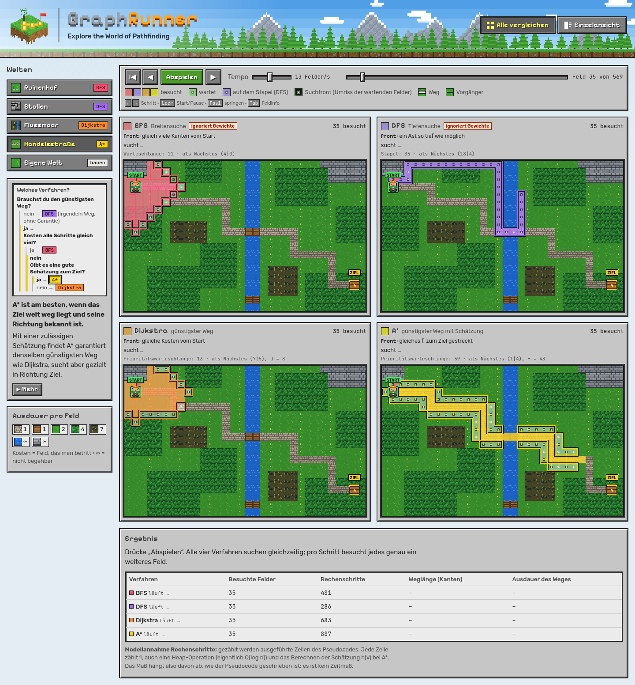
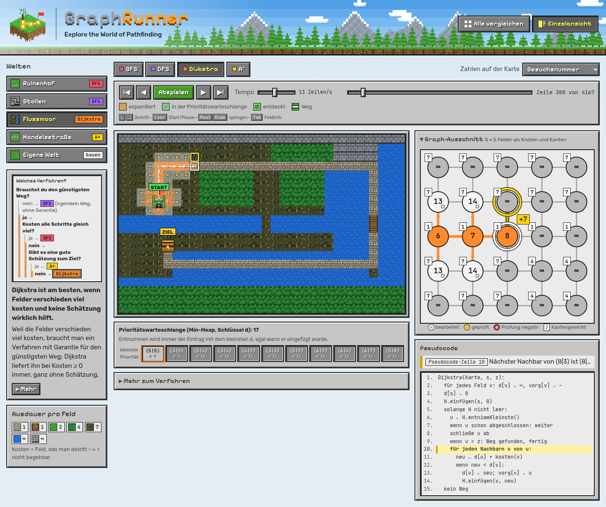

# GraphRunner

Ein Pixel-Spiel im Browser, das zeigt, **wann welcher Suchalgorithmus der beste ist**: BFS, DFS, Dijkstra und A* suchen gleichzeitig auf derselben Karte, Schritt für Schritt und mit Pseudocode.

**Live:** https://xeniannr-hub.github.io/graphrunner/



Hochschulprojekt im Modul *Theoretische Informatik* an der DHBW Ravensburg.

## Welten

Jede Welt ist so gebaut, dass ein Verfahren dort am besten abschneidet. Die Bedingungen prüft `src/world/worlds.test.ts`.

| Welt | Bestes Verfahren | Warum | Gemessen |
| --- | --- | --- | --- |
| Ruinenhof | BFS | jeder Schritt kostet gleich viel | weniger Rechenschritte als Dijkstra (6.982 zu 9.928) bei gleichem Weg |
| Stollen | DFS | Labyrinth mit nur einem Weg | DFS besucht 61 Felder, < 70 % jedes anderen Verfahrens |
| Flussmoor | Dijkstra | Kosten verschieden, Schätzung hilft kaum | weniger Rechenschritte als A* (4.167 zu 4.356) |
| Handelsstraße | A* | Ziel weit weg, Richtung bekannt | A* besucht 43 statt 424 Felder wie Dijkstra |
| Eigene Welt | – | selbst bauen | – |

## Bedienung

- **Alle vergleichen:** vier Karten nebeneinander. Die Umrisslinie zeigt die **Suchfront**, also die Felder, die gerade in der Datenstruktur warten. Darunter: beste Wahl, Fazit und Ergebnistabelle.
- **Einzelansicht:** ein Verfahren Zeile für Zeile, wie im Debugger, mit Datenstruktur, Pseudocode und aufklappbarem Mini-Graph (5 × 5 Felder als Knoten und Kanten).
- **Welches Verfahren?** Ein Entscheidungsbaum in der Seitenleiste führt über die Voraussetzungen zum passenden Verfahren.
- **Eigene Welt:** Gelände malen, alle Verfahren rechnen sofort neu.
- **Tastatur:** `←` / `→` ein Schritt, Leertaste Abspielen/Pause, `Pos1` / `Ende` Anfang/Ende. Ein Tooltip zeigt zu jedem Feld Gelände, Kanten mit Gewicht und Besuchsnummer.



## Modell

- Karte mit 32 × 20 Feldern. Jedes begehbare Feld ist ein Knoten, Nachbarn sind die vier direkten Felder (keine Diagonalen).
- **Kostenregel:** Die Kante u → v kostet so viel wie das Feld v. Der Graph ist deshalb gerichtet: Hin- und Rückweg können verschieden teuer sein.
- **Nachbarreihenfolge:** fest **oben, rechts, unten, links** (`src/algorithms/raster.ts`). Bei gleicher Priorität gewinnt der ältere Eintrag, jeder Lauf ist reproduzierbar.
- **Heuristik von A\*:** `h(v) = Manhattan-Abstand(v, Ziel) × billigstes begehbares Feld`. Sie ist zulässig und konsistent; Tests auf Zufallskarten prüfen beides.
- Negative Kosten werden abgelehnt, Kosten 0 sind erlaubt.

| Gelände | Weg | Brücke | Wiese | Wald | Sumpf | Wasser | Fels |
| --- | --- | --- | --- | --- | --- | --- | --- |
| Ausdauer | 1 | 1 | 2 | 4 | 7 | ∞ | ∞ |

| Verfahren | Datenstruktur | Findet |
| --- | --- | --- |
| BFS | Warteschlange (FIFO) | Weg mit den wenigsten Kanten |
| DFS | Stapel | irgendeinen Weg |
| Dijkstra | Prioritätswarteschlange (Min-Heap) nach g | günstigsten Weg |
| A* | Prioritätswarteschlange nach f = g + h | günstigsten Weg |

**Annahmen hinter den Messwerten:** Ein Rechenschritt ist eine ausgeführte Pseudocode-Zeile, auch eine Heap-Operation; bei A* zählt das Berechnen von h(v) als eigener Schritt. Der Vorteil der DFS im Stollen hängt an der festen Nachbarreihenfolge: Nur 12 von 24 Reihenfolgen erfüllen die Bedingung, DFS hat dort also Glück.

## Starten

Voraussetzung: Node 22 oder neuer.

```bash
npm install            # einmalig
npm run dev            # Entwicklungsserver
npm test               # Tests
npm run test:leistung  # Zeitmessung (< 100 ms je Welt)
npm run build          # Typprüfung und Build nach dist/
```

## Ordnerstruktur

```text
src/
  algorithms/   BFS, DFS, Dijkstra, A* als Generatoren, Heap, Pseudocode
  replay/       Aufzeichnung vor- und zurückspielen
  world/        Gelände und die fünf Welten
  info/         Steckbriefe der Verfahren
  render/       Karte und Mini-Graph (Canvas 2D)
  ui/           Oberfläche: Vergleich, Einzelansicht, Seitenleiste, Tooltip
prototype/      erster Prototyp, nur zum Nachschlagen
docs/           Bildschirmfotos und Designentwürfe
.github/        Workflows pruefen.yml und deploy.yml
```

Die Algorithmen kennen weder DOM noch Canvas, deshalb laufen alle Tests ohne Browser.

## Team

- Xenia Penner
- Finia Held
- Kiana Martini
- Lisa Franjic

## Deployment

Jeder Pull Request wird geprüft (`pruefen.yml`: Formatierung, Tests, Build). Jeder Push auf `main` testet, baut und veröffentlicht automatisch auf GitHub Pages (`deploy.yml`). Schlagen die Tests fehl, wird nichts veröffentlicht.

## Quellen

- Dijkstra, E. W. (1959): A note on two problems in connexion with graphs. *Numerische Mathematik* 1, 269–271.
- Hart, P. E.; Nilsson, N. J.; Raphael, B. (1968): A Formal Basis for the Heuristic Determination of Minimum Cost Paths. *IEEE Transactions on Systems Science and Cybernetics* 4(2), 100–107.
- Tarjan, R. E. (1972): Depth-First Search and Linear Graph Algorithms. *SIAM Journal on Computing* 1(2), 146–160.
- Brown, M. H.; Sedgewick, R. (1984): A System for Algorithm Animation. *Computer Graphics* 18(3), 177–186.
- Alle Grafiken sind eigene Entwürfe. Schriften: Pixelify Sans, Rubik, JetBrains Mono (SIL Open Font License).
